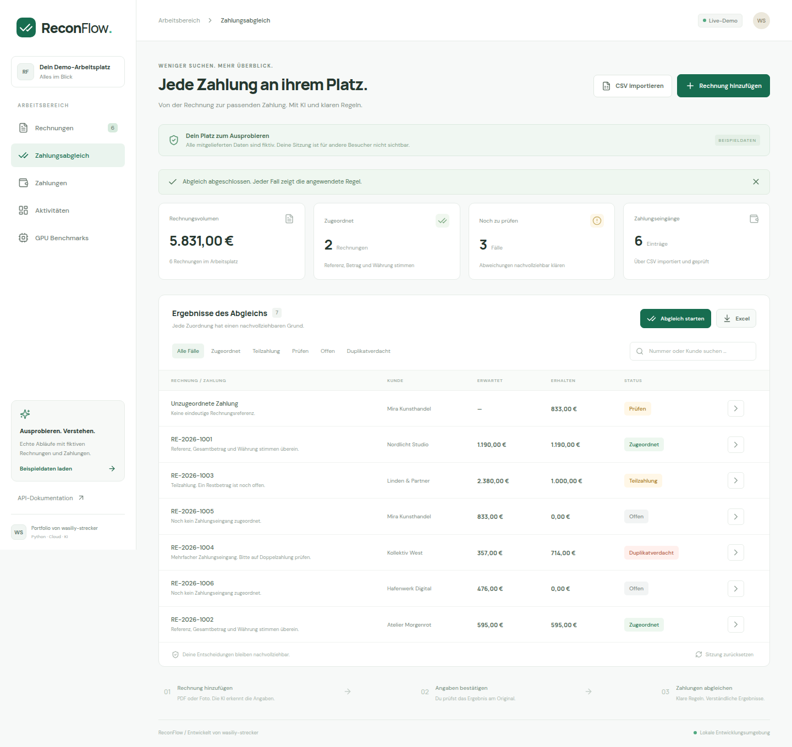
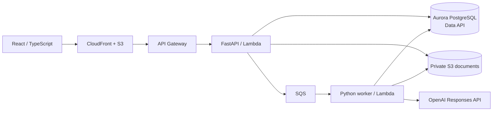

# ReconFlow

**Rechnungen mit KI auslesen. Angaben prüfen. Zahlungseingänge nachvollziehbar abgleichen.**

Ein eigenständiges Portfolio-Projekt von wasiliy-strecker mit Python, FastAPI,
PostgreSQL, OpenAI, Docker und einer AWS-Testumgebung in Stockholm.



## Ausprobieren

AWS-Test: **https://d33v3exmdsu4yz.cloudfront.net**. Dort **Demo starten** wählen.
Die öffentliche Umgebung akzeptiert ausschließlich synthetische Beispieldateien.

Voraussetzung: Docker Engine mit Compose und Buildx. Mindestens 3 GB freier
Speicherplatz für Images und Build-Caches. Ein OpenAI-Schlüssel ist für die
Beispieldaten nicht nötig, für echte KI-Auswertung schon.

```bash
python3 scripts/init_env.py
# OPENAI_API_KEY in der privaten .env ergänzen. Niemals committen.
docker compose up --build -d
```

Öffnen: **http://localhost:5173**. API-Dokumentation: http://localhost:5173/api/docs.
Die Ports sind ausschließlich an localhost gebunden. PostgreSQL, S3/SQS-Emulator,
Setup, API, Worker und Frontend sind enthalten. Das Setup darf erfolgreich mit Exit 0 enden.

1. **Demo starten** lädt sechs synthetische Rechnungen und sechs Zahlungen.
2. Eine Rechnung öffnen und **Mit KI auslesen** wählen. Das ist ein echter OpenAI-Aufruf.
3. Erkannte Angaben am Original prüfen und **Angaben bestätigen** wählen.
4. **Abgleich starten** zeigt passende Zahlungen, Teilzahlungen und Duplikatverdacht.
5. Bei der unzugeordneten Mira-Zahlung einen KI-Vorschlag anfordern und selbst zuordnen.
6. **Excel** lädt einen Bericht mit Abgleich, Rechnungen, Zahlungen und Importen herunter.

Vorbefüllte Beispieldaten sind ausdrücklich als **Beispielwerte** gekennzeichnet.
KI-Ergebnisse werden niemals automatisch bestätigt oder als Buchung ausgeführt.
Eigene PDF/JPG/PNG und CSV sind nur im lokalen Modus erlaubt. Die öffentliche
AWS-Demo akzeptiert ausschließlich die enthaltenen synthetischen Dateien.

Der AWS-Test läuft im bestehenden **Free Plan**. Die Stockholm-Konfiguration
verwendet Aurora Express; GitHub-OIDC ist zunächst deaktiviert.
OpenAI bleibt separat kostenpflichtig und mit dem bestehenden Budget nutzbar.
Den AWS-Zugang prüfst du ohne Ressourcenerstellung mit:

```bash
uv run --frozen python scripts/prepare_aws_demo.py
```

## Technischer Aufbau



Lokal ersetzen PostgreSQL und Moto die AWS-Dienste. Derselbe Python-Code nutzt
Psycopg lokal und die RDS Data API auf AWS. API, Worker und Migration laufen aus
demselben Container-Image mit unterschiedlichen Einstiegspunkten.

- **Python 3.12, FastAPI, Pydantic:** typisierte API und validierte Rechnungsdaten.
- **PostgreSQL 17:** Transaktionen, Versionsprüfung, SQL-Migrationen und Audit-Ereignisse.
- **OpenAI:** strukturierte PDF-/Bilderkennung, Fundstellen und begrenzte Zuordnungsvorschläge.
- **Decimal-Abgleich:** Referenz und Währung, Teilzahlungen, Mehrdeutigkeit und Überzahlungen.
- **Docker Compose:** vollständige lokale Umgebung mit getrenntem API- und Worker-Prozess.
- **AWS-Testumgebung:** Lambda, Aurora Serverless v2, S3, SQS und Terraform.
- **CI/CD:** automatische Tests und ein manuell gestarteter AWS-Release per GitHub OIDC.

Details: [Architektur](docs/ARCHITECTURE.md), [Dateiformate](docs/DATA_FORMATS.md),
[AWS-Betrieb](docs/AWS_RUNBOOK.md), [Kostenannahmen](docs/COSTS.md).

## Nachgewiesener Stand

- 55 Python-Tests mit lokalen PostgreSQL-/S3-Adaptern, simulierten KI-Antworten und AWS-Vorbereitung.
- Sechs Terraform-Tests mit simuliertem AWS-Provider prüfen Stockholm, Free-Plan-Vorgaben und optionales OIDC.
- Ein Browser-Test deckt Import, Prüfung, Abgleich, manuelle Zuordnung und XLSX-Download ab.
  Lokal zusätzlich mit echten OpenAI-Aufrufen für Extraktion und Zuordnung ausgeführt.
- Echte KI-Smoke-Evaluation: **27/27 Kopffelder** bei drei synthetischen PDF-/PNG-/JPEG-Rechnungen.
  Kein Beleg für eine allgemeine Erkennungsquote. Positionen wurden nicht in dieser Quote bewertet.
- Engine-Benchmark: **50.000 Rechnungen + 50.000 Zahlungen in 3,165 Sekunden** auf der lokalen
  Entwicklungsmaschine. Ohne Datenbank, Upload und KI. Das Demo-Limit bleibt deutlich kleiner.
- Produktions-Frontend und Docker-Images gebaut. Beide Terraform-Module lokal validiert.

Messprotokolle: [KI-Evaluation](docs/evaluation/latest.json), [Benchmark](docs/evaluation/benchmark.json).
Die AWS-Testumgebung wurde am 15.11.2026 provisioniert und im Browser einschließlich
zweier echter OpenAI-Aufrufe geprüft. Getestet wurden außerdem Sitzungstrennung,
CSRF/Origin-Schutz, Beispiel-Dateigrenzen und gesperrter direkter S3-Zugriff.
Terraform meldet nach dem Deployment keine Abweichungen. Die Datenbank pausierte
nachweislich auf 0 ACU; der anschließende Browserstart benötigte rund 24 Sekunden.
Nach einer Ruhephase daher kurz auf das Laden der Beispieldaten warten.
Die GitHub-Workflows sind vorbereitet, aber noch nicht auf GitHub ausgeführt.

## Entwickeln und testen

Zusätzlich erforderlich: Python 3.12, uv und Node.js 22.

```bash
uv sync --frozen
cd frontend
npm ci
cd ..
docker compose up -d --wait db aws
uv run python -m reconflow.bootstrap
make lint
make test
# Worker während direkter Integrationstests stoppen, damit er keine Test-Jobs übernimmt.
docker compose stop worker
make integration
docker compose start worker
cd frontend
npx playwright install chromium
npm run test:e2e
```

Die Browserprüfung benötigt die laufende Compose-Anwendung. Die Standardtests
verbrauchen kein OpenAI-Guthaben. Die folgenden Befehle rufen OpenAI kostenpflichtig auf:

```bash
uv run python scripts/evaluate_ai.py --execute --limit 3
cd frontend
RECONFLOW_LIVE_AI=1 npm run test:e2e
```

Der reproduzierbare reine Python-Benchmark ist `uv run python scripts/benchmark.py`.
Migrationen sind nummerierte SQL-Dateien mit Prüfsummen. Bereits angewandte Dateien
werden nicht verändert. Neue Datenbankänderungen erhalten eine neue Migration.

## Betrieb und Grenzen

Die Demo-Sitzung läuft nach 24 Stunden ab. SQL-Daten werden bei späterer Sitzungsanlage
aufgeräumt. AWS-S3 löscht Dokumente zeitversetzt per Lifecycle. Lokal überlebt eine private
Dokumentkopie im Docker-Volume einen Neustart des flüchtigen Moto-Emulators. Lokale Volumes
bleiben bis zu ihrer ausdrücklichen Entfernung erhalten.

`docker compose down` stoppt die Anwendung und erhält die Daten.
`docker compose down -v` entfernt **alle lokalen ReconFlow-Daten und das lokale KI-Budgetbuch**.
Ein Neuaufsetzen ersetzt keine Abrechnungsgrenze beim Anbieter.

Das ReconFlow-KI-Budget beträgt standardmäßig 10 EUR pro Kalendermonat. Vor jedem Aufruf
wird konservativ Budget reserviert, bei bekanntem Verbrauch wieder abgerechnet.
Andere Anwendungen mit demselben Schlüssel sind darin nicht enthalten. Modellpreise
und Wechselkursannahmen müssen bei einem Modellwechsel überprüft werden.

Nicht enthalten: produktive Mandantenverwaltung, Bankanbindung, rechtssichere Buchführung,
Abonnements oder ein veröffentlichter AWS-Marketplace-Eintrag. Diese Demo ist eine
nachvollziehbare Grundlage für Bewerbungen und spätere Produktentwicklung.

## Lizenz

[MIT](LICENSE). Synthetische Beispieldaten gehören zum Projekt. Abhängigkeiten behalten
ihre jeweiligen Lizenzen. Personen- und Unternehmensnamen in Rechnungen sind Testdaten.
